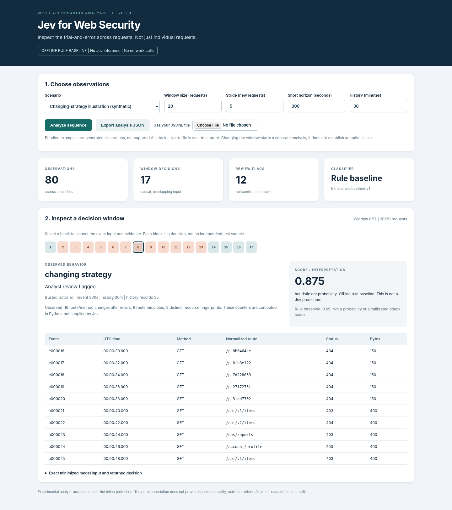

# Jev for Web Security

**Expose the trial-and-error behind AI-agent-driven web attacks, not just individual requests.**

Read-only, sequence-level web/API investigation with configurable windows and an explicit Jev backend. Independent research software, not an official TypeSafe or Black Hat product.

> **Status:** functional offline prototype. The Jev HTTP client is implemented against the official API schema but has not been validated with live credentials in this package. Bundled traces are synthetic illustrations. No accuracy, AI-attribution or production-protection claim is made.



## Start in one command

Python 3.10 or later is required; there are no third-party Python dependencies.

```sh
python run.py
```

On Windows, double-click `START_WINDOWS.bat`. On macOS/Linux, use `python3 run.py` from the extracted repository folder. Open `http://127.0.0.1:8765/` if the browser does not open automatically. The default is the **offline rule baseline**, with no external API calls.

1. Select a scenario and click **Analyze sequence**.
2. Select a numbered window, or change the window size and rerun.
3. Inspect the exact input and export the analysis JSON.

## Real Jev mode

```sh
python run.py serve --engine jev --ask-key
```

Enter your TypeSafe key in the local terminal prompt; it is not saved. The browser never receives the key. Review the data and tick the external-API consent box before running. The pinned default is `jev-1.14.0`; override with `--model` when appropriate. No rule result is substituted if Jev fails. API use can incur charges. Model confidence is not a validated security probability.

## What is implemented

- Causal per-entity windows, partial-window evaluation and two time horizons.
- Deterministic feature extraction and conservative data minimization.
- Offline rule baseline and an explicit System One API backend.
- Local timeline, evidence table and JSON export.
- Normalized JSONL and a documented ModSecurity v3 JSON subset.
- Generated examples and 28 offline/contract tests.

The browser reads request/response **metadata**, not response bodies. No scanner, exploit, blocking rule or model weight is distributed. ASN enrichment and live WAF feedback are not implemented.

## Defaults

| Setting | Initial value | Meaning |
|---|---:|---|
| Request window N | 20 | Maximum recent records |
| Stride S | 5 | Re-evaluate at entity request counts 5, 10, 15... |
| Short horizon | 300 seconds | Exclude older records from ordered window |
| History horizon | 1800 seconds | Summary including current and recent events |
| First observation | Evaluated | Partial windows do not wait to fill |

A new event after a short-horizon gap also triggers assessment. There is no idle timer or end-of-file flush. See [window semantics](docs/WINDOWS.md).

## CLI and tests

```sh
python run.py analyze --input examples/adaptive_illustration.jsonl --window 20 --stride 5
python -m unittest discover -s tests -v
```

CLI output defaults to `outputs/result.json`, which is excluded from Git. For live CLI inference, also specify `--engine jev --ask-key --allow-external-api`. Only use logs you are authorized to process.

## Documentation

[Editable English tool guide (Word)](docs/TOOL_GUIDE_EN.docx) | [English tool guide (PDF)](docs/TOOL_GUIDE_EN.pdf) | [English guide (Markdown)](docs/TOOL_GUIDE_EN.md) | [Japanese quick start](README_JA.md) | [Security and limitations](docs/SECURITY.md) | [Evaluation plan](docs/EVALUATION_PLAN.md) | [Verification status](docs/STATUS.md)

## License and contribution

Repository code is provided under the [MIT license](LICENSE). The hosted Jev service has its own terms and is not included in that license. See [third-party notices](THIRD_PARTY_NOTICES.md). Contributions should preserve explicit provenance, causal windowing, privacy defaults and clear separation between rule and model outputs.
